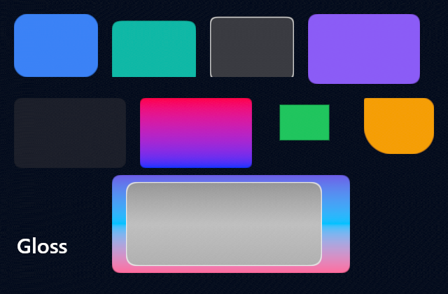

# Gloss

Gloss is a Rust GUI framework for macOS-style visuals: glassmorphism, Liquid
Glass refraction and specular highlights, neumorphism, claymorphism, continuous
(squircle) corners and soft multi-layer shadows. Styles are plain Rust data built
with a fluent API, layout uses `taffy`, text uses `cosmic-text`, and rendering is
GPU-first via `wgpu`.



## Hello glass

```rust
use gloss::{Align, App, Edges, FlexDirection, Node, Style, TextStyle, Theme, glass};

fn main() {
    App::new().title("Hello Glass").size(720.0, 480.0).run(|doc| {
        let theme = Theme::dark();
        let root = doc.root();
        doc.set_style(root, Style::new()
            .fill(theme.background)
            .align_items(Align::Center)
            .justify_content(Align::Center));
        let card = doc.add(root, Node::panel(glass(&theme)
            .width(360.0)
            .padding(Edges::all(28.0))
            .gap(10.0)
            .flex_direction(FlexDirection::Column))).expect("card");
        doc.add(card, Node::label("Hello Glass",
            TextStyle::new(28.0).weight(700).color(theme.text)));
        doc.add(card, Node::label("A blurred, tinted panel with a bright rim.",
            TextStyle::new(15.0).line_height(22.0).color(theme.text_dim)));
    });
}
```

Run it with `cargo run -p gloss --example gallery` to see every preset, the
Card/Toggle/Slider widgets and Primary/Secondary/Ghost buttons. Other examples:
`control_center` (frosted dashboard with glass tiles, toggles, sliders, a
scrollable device list and hover-animated accents), `presentation`
(keyboard-driven slides with `show`/`for_each` and the debug overlay),
`glass_card` and `counter`.

## Status

M0-M9 are implemented: SDF box renderer, styles and themes, retained tree and
signals, layout/text/clipping/scroll, backdrop blur and glass, interaction
states and animation, Liquid Glass parameters, widgets, presets, golden-image
harness, the vibrancy API and hot reload. Post-M8 work adds `Dynamic<T>`
bindings, `Document::show`/`for_each` structural bindings, LRU glyph-atlas
eviction, GPU timestamp timing with a CPU fallback, a per-frame `RenderStats`
overlay (F1) and an allocation counter. M9 reloads the `gloss-styles` cdylib in
place; see `DECISIONS.md` (D17) and `examples/hot_reload.rs`. The app now ticks
style transitions each frame, so hover/press animations actually run. Shadow and
glass aux data use pair indices consistently (the golden baseline was re-blessed
after fixing the old vec4-index mismatch).

```sh
# terminal 1: rebuild the styles crate on change
cargo watch -w crates/gloss-styles -x "build -p gloss-styles"
# terminal 2: run the app
cargo run -p gloss --example hot_reload
```

Known v0.1 limitations: no rotation transforms, one rounded clip level, glass
nesting capped at depth 2, no IME, sRGB output only, and grayscale text AA only.

## Build and test

```sh
cargo fmt
cargo clippy --workspace --all-targets -- -D warnings
cargo test --workspace --all-targets
```

Golden images live under `tests/golden/<os>-<backend>/`. Re-bless one with
`GLOSS_BLESS=1` (PowerShell: `$env:GLOSS_BLESS="1"; cargo test -p gloss-render --test golden`).
The screenshot above is the current headless golden render.
